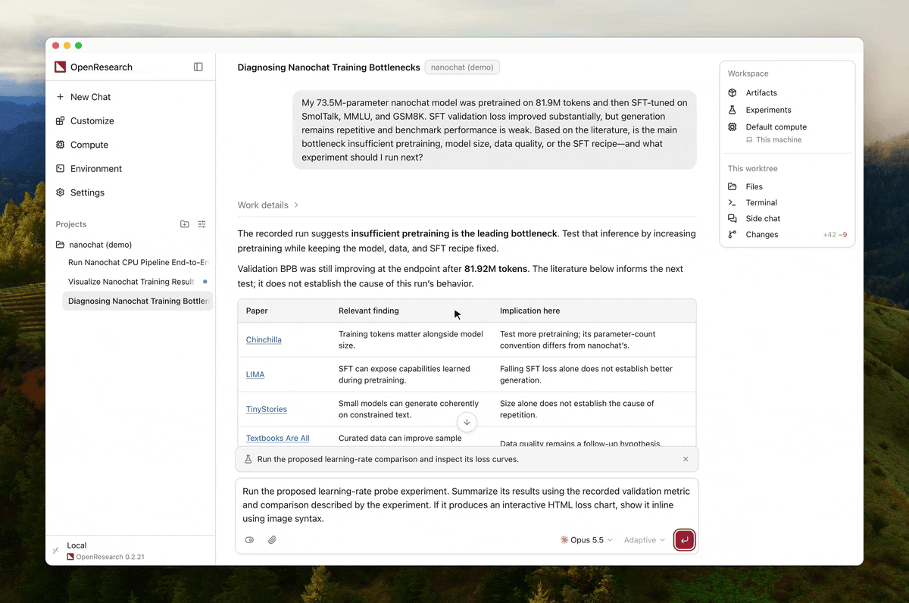
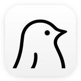

<div align="center">

<h1> OpenResearch</h1>

रिसर्च एजेंटों के लिए लोकल-फ़र्स्ट हार्नेस और वर्कस्पेस।

<p><em>an <a href="https://alphaxiv.org"> alphaXiv</a> project</em></p>

<p>
<a href="https://github.com/alphaXiv/OpenResearch/releases/latest"></a>
<a href="https://github.com/alphaXiv/OpenResearch/blob/main/LICENSE"></a>
</p>

<p><a href="README.md">English</a> · <a href="README.es.md">Español</a> · <a href="README.ko.md">한국어</a> · <a href="README.zh.md">简体中文</a> · <a href="README.ja.md">日本語</a> · <a href="README.ru.md">Русский</a> · <a href="README.tr.md">Türkçe</a> · <a href="README.vi.md">Tiếng Việt</a> · <a href="README.hi.md">हिन्दी</a> · <a href="README.te.md">తెలుగు</a></p>

<p></p>

<hr />

<p>चाहे आपको कोपायलट चाहिए या ऑटोरिसर्च टूल, OpenResearch आपके काम की रफ़्तार बढ़ाएगा। ऐसे रिसर्च एजेंट लॉन्च करें जो साहित्य की समीक्षा कर सकें, परिकल्पनाएँ विकसित कर सकें, प्रयोग चला सकें और रिसर्च आर्टिफ़ैक्ट तैयार कर सकें।</p>

<p>
<a href="https://openresearch.sh/dl/macos?src=github"><picture><source media="(prefers-color-scheme: dark)" srcset=".github/readme-assets/download-macos-dark.svg"></picture></a>
<a href="https://openresearch.sh/dl/windows?src=github"><picture><source media="(prefers-color-scheme: dark)" srcset=".github/readme-assets/download-windows-dark.svg"></picture></a>
<a href="https://openresearch.sh/dl/linux_x64?src=github"><picture><source media="(prefers-color-scheme: dark)" srcset=".github/readme-assets/download-linux-dark.svg"></picture></a>
</p>

<p>
<a href="https://openresearch.sh/docs"></a>
<a href="https://github.com/alphaXiv/OpenResearch/releases"></a>
</p>

<p><sub>macOS 11+ · Windows बीटा के लिए <a href="https://gitforwindows.org">Git for Windows</a> ज़रूरी है · <a href="https://openresearch.sh/docs/install">Linux</a> ऐप के लिए glibc 2.35+ चाहिए</sub></p>

<p><a href="https://trendshift.io/repositories/89363"></a>
<a href="https://trendshift.io/repositories/89363?utm_source=trendshift-badge&amp;utm_medium=badge&amp;utm_campaign=badge-trendshift-89363" target="_blank" rel="noopener noreferrer"></a></p>

</div>

## शुरू करें

**हम OpenResearch डेस्कटॉप ऐप इस्तेमाल करने की सलाह देते हैं।** अपने प्लेटफ़ॉर्म के लिए इसे डाउनलोड करें:

- [macOS](https://openresearch.sh/dl/macos?src=github)
- [Windows (बीटा)](https://openresearch.sh/dl/windows?src=github)
- Linux: [x86_64](https://openresearch.sh/dl/linux_x64?src=github) · [ARM64](https://openresearch.sh/dl/linux_arm64?src=github)

<details>
<summary>स्टैंडअलोन CLI पसंद है? macOS या Linux पर इंस्टॉल करें</summary>

```sh
curl -LsSf https://openresearch.sh/install.sh | sh
orx up
```

`orx up` लोकल डैशबोर्ड को `http://127.0.0.1:4791` पर खोलता है।

किसी संस्था द्वारा मैनेज किए जाने वाले Mac पर, डिवाइस-मैनेजमेंट नीतियाँ `install.sh` से
इंस्टॉल किए गए CLI को ब्लॉक कर सकती हैं, क्योंकि वह अभी साइन नहीं किया गया है। इसके बजाय
साइन और नोटराइज़ किया गया डेस्कटॉप ऐप इस्तेमाल करें। आप ऐप की
सेटिंग्स → अपडेट → **`orx` कमांड इंस्टॉल करें** से अपने टर्मिनल के लिए `orx` भी इंस्टॉल कर सकते हैं।

</details>

ईमेल पर अपडेट पाने और मैनेज्ड OpenResearch कंप्यूट इस्तेमाल करने के लिए
[openresearch.sh](https://openresearch.sh) पर खाता बनाएँ।

## यह कैसे काम करता है

**अपना पसंदीदा कोडिंग एजेंट इस्तेमाल करें।** OpenResearch  Claude Code,
 Codex,
 OpenCode,
 Cursor और
 Google Antigravity के साथ सीधे काम करता है।
आप OpenCode के साथ
 LM Studio,
 oMLX,
 Rapid-MLX,
 Ollama या किसी कस्टम एंडपॉइंट के ज़रिए [लोकल मॉडल भी इस्तेमाल कर सकते हैं](https://openresearch.sh/docs/agents)।

**रिसर्च परिकल्पनाओं को नवीनतम साहित्य पर आधारित करें।** OpenResearch  alphaXiv,  bioRxiv और  PubMed के साथ इंटीग्रेट होता है, ताकि एजेंट प्रासंगिक पेपर ढूँढ सकें, सोच-समझकर परिकल्पनाएँ बना सकें और अपने प्रयोगों को मौजूदा रिसर्च से जोड़ सकें।

**अपना कंप्यूट चुनें।** प्रयोग लोकल रूप से चलाएँ या SSH,
Slurm,
 Kubernetes,
 Modal,
 Tinker,
 Ray,
 Hugging Face Jobs और
मैनेज्ड OpenResearch कंप्यूट का इस्तेमाल करें।

**एजेंटों को हर प्रयोग की याद दें।** OpenResearch हर प्रयोग को एक लोकल SQL डेटाबेस में दर्ज करता है और उसके लॉग, कोड
और आर्टिफ़ैक्ट आपकी मशीन पर रखता है, ताकि एजेंट
पिछले नतीजों से सीख सकें और तय कर सकें कि आगे क्या आज़माना है। डेस्कटॉप ऐप से यह
देखना आसान हो जाता है कि आपके एजेंटों ने क्या किया है, और हर नतीजे के पीछे के सबूत जाँचना भी।

**अपनी रिसर्च अपने पास और अपने अधिकार में रखें।** सब कुछ पूरी तरह लोकल रूप से चलाएँ। हम आपका कोड या एजेंट ट्रेस इकट्ठा नहीं करते। आपके प्रोजेक्ट,
बातचीत, प्रयोग, लॉग और आर्टिफ़ैक्ट आपकी मशीन पर, आपके
नियंत्रण में रहते हैं।

## उपयोग एनालिटिक्स

आधिकारिक रिलीज़ बिल्ड बैकग्राउंड में मोटे तौर के प्रोडक्ट एनालिटिक्स इवेंट और एजेंट का विस्तृत फ़ीडबैक भेजते हैं, जो एक रैंडम
इंस्टॉलेशन ID से जुड़े होते हैं। ये डिफ़ॉल्ट रूप से चालू रहते हैं और आप इन्हें बंद कर सकते हैं। आपका कोड, प्रॉम्प्ट, फ़ाइलों की सामग्री या पाथ,
रिपॉज़िटरी के नाम, टोकन, ईमेल, या प्रोजेक्ट और प्रयोग के आइडेंटिफ़ायर इकट्ठा नहीं किए जाते। गुमनाम टोकन/संदेश गिनती से यह पता लगाया जाता है
कि OpenResearch में कौन-से मॉडल इस्तेमाल हो रहे हैं, और इसे https://openresearch.sh/rankings पर देखा जा सकता है। एजेंट की फ़ीडबैक रिपोर्ट
बग रिपोर्ट, फ़ीचर अनुरोधों और OpenResearch से जुड़ी आम परेशानियों के लिए भेजी जाती हैं। एजेंटों को
निर्देश दिया गया है कि वे रिपोर्ट से आपकी रिसर्च या कोड के बारे में हर संवेदनशील जानकारी हटा दें।

आप डेस्कटॉप ऐप की
सेटिंग्स में या `orx telemetry off` से सभी उपयोग एनालिटिक्स और एजेंट फ़ीडबैक बंद कर सकते हैं।
