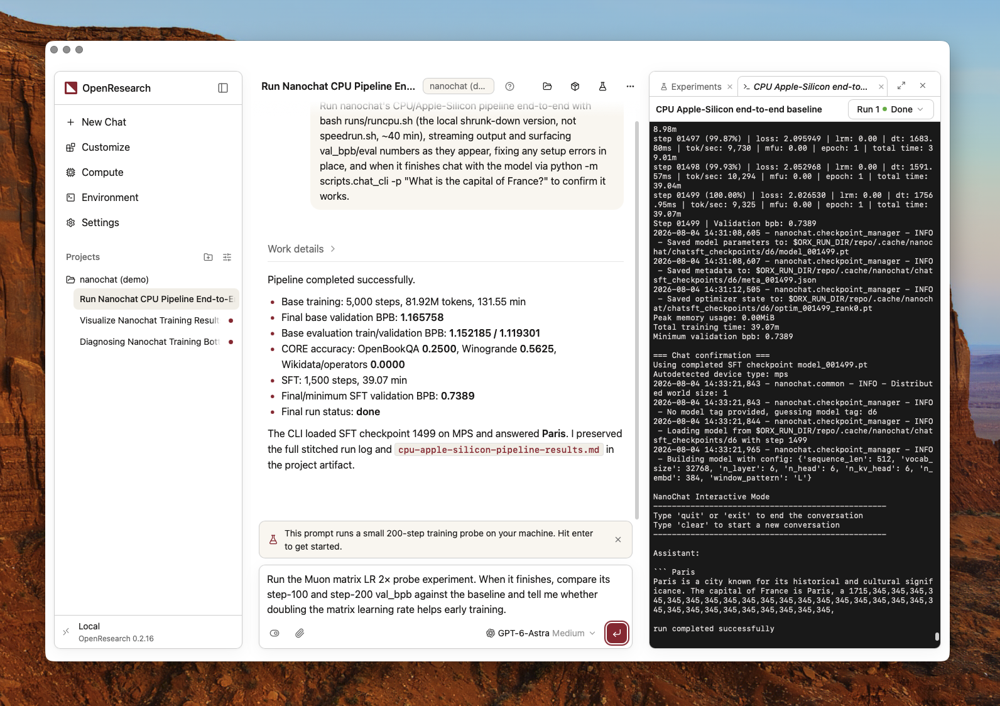

<div align="center">

<h1> OpenResearch</h1>

Локальная среда и рабочее пространство для исследовательских агентов.

<p><em>проект <a href="https://alphaxiv.org"> alphaXiv</a></em></p>

<p>
<a href="https://github.com/alphaXiv/OpenResearch/releases/latest"></a>
<a href="https://github.com/alphaXiv/OpenResearch/blob/main/LICENSE"></a>
</p>

<p><a href="README.md">English</a> · <a href="README.es.md">Español</a> · <a href="README.ko.md">한국어</a> · <a href="README.zh.md">简体中文</a> · <a href="README.ja.md">日本語</a> · <a href="README.ru.md">Русский</a></p>

<p></p>

<hr />

<p>Нужен ли вам помощник или инструмент для автономных исследований, OpenResearch ускорит вашу работу. Запускайте исследовательских агентов, которые изучают литературу, выдвигают гипотезы, ставят эксперименты и готовят исследовательские материалы.</p>

<p>
<a href="https://github.com/alphaXiv/OpenResearch/releases/latest/download/OpenResearch.dmg"><picture><source media="(prefers-color-scheme: dark)" srcset=".github/readme-assets/download-macos-dark.svg"></picture></a>
<a href="https://github.com/alphaXiv/OpenResearch/releases/latest/download/OpenResearch-Setup.exe"><picture><source media="(prefers-color-scheme: dark)" srcset=".github/readme-assets/download-windows-dark.svg"></picture></a>
<a href="https://github.com/alphaXiv/OpenResearch/releases/latest/download/OpenResearch-x86_64.AppImage"><picture><source media="(prefers-color-scheme: dark)" srcset=".github/readme-assets/download-linux-dark.svg"></picture></a>
</p>

<p>
<a href="https://openresearch.sh/docs"></a>
<a href="https://github.com/alphaXiv/OpenResearch/releases"></a>
</p>

<p><sub>macOS 11+ · Для бета-версии под Windows нужен <a href="docs/windows.md">Git for Windows</a> · Приложению для <a href="docs/linux.md">Linux</a> нужна glibc 2.35+</sub></p>

<p><a href="https://trendshift.io/repositories/89363"></a>
<a href="https://trendshift.io/repositories/89363?utm_source=trendshift-badge&amp;utm_medium=badge&amp;utm_campaign=badge-trendshift-89363" target="_blank" rel="noopener noreferrer"></a></p>

</div>

## Начало работы

**Мы рекомендуем настольное приложение OpenResearch.** Скачайте его для своей платформы:

- [macOS](https://github.com/alphaXiv/OpenResearch/releases/latest/download/OpenResearch.dmg)
- [Windows (бета)](https://github.com/alphaXiv/OpenResearch/releases/latest/download/OpenResearch-Setup.exe)
- Linux: [x86_64](https://github.com/alphaXiv/OpenResearch/releases/latest/download/OpenResearch-x86_64.AppImage) · [ARM64](https://github.com/alphaXiv/OpenResearch/releases/latest/download/OpenResearch-aarch64.AppImage)

<details>
<summary>Предпочитаете отдельный CLI? Установка в macOS или Linux</summary>

```sh
curl -LsSf https://openresearch.sh/install.sh | sh
orx up
```

`orx up` открывает локальную панель по адресу `http://127.0.0.1:4791`.

На Mac, которым управляет организация, политики управления устройствами могут
заблокировать CLI, установленный через `install.sh`, потому что он пока не
подписан. Используйте вместо него подписанное и нотаризованное настольное
приложение. Установить `orx` для терминала можно и из приложения: Настройки →
Обновления → **Установить команду `orx`**.

</details>

Создайте аккаунт на [openresearch.sh](https://openresearch.sh), чтобы получать
новости по почте и пользоваться управляемыми вычислениями OpenResearch.

## Как это работает

**Работайте с любимым агентом для программирования.** OpenResearch напрямую поддерживает  Claude Code,
 Codex,
 OpenCode,
 Cursor и
 Google Antigravity.
Можно также [использовать локальную модель](docs/local-models.md) с OpenCode через
 LM Studio,
 oMLX,
 Ollama или собственный адрес сервера.

**Опирайте гипотезы на свежую литературу.** OpenResearch интегрирован с  alphaXiv,  bioRxiv и  PubMed, поэтому агенты находят подходящие статьи, выдвигают обоснованные гипотезы и связывают свои эксперименты с существующими исследованиями.

**Выбирайте, где считать.** Запускайте эксперименты локально или через SSH,
Slurm,
 Kubernetes,
 Modal,
 Tinker,
 Ray,
 Hugging Face Jobs и
управляемые вычисления OpenResearch.

**Дайте агентам память о каждом эксперименте.** OpenResearch записывает каждый эксперимент в локальную SQL-базу и хранит его логи, код
и артефакты на вашем компьютере, чтобы агенты могли
учиться на прошлых результатах и решать, что попробовать дальше. В настольном приложении
легко увидеть, что сделали ваши агенты, и проверить данные, на которых основан каждый результат.

**Ваши исследования остаются вашими.** Всё работает полностью локально. Мы не собираем ваш код и трассы агентов. Ваши проекты,
разговоры, эксперименты, логи и артефакты остаются на вашем компьютере и под вашим
контролем.

## Статистика использования

Официальные релизные сборки отправляют обобщённые события использования, привязанные
к случайному ID установки; эту отправку можно отключить. В них нет кода, запросов,
содержимого файлов и путей, названий репозиториев, токенов, адресов почты, а также
идентификаторов проектов и экспериментов.

Отключить статистику использования можно в настройках настольного приложения или командой `orx telemetry off`.
