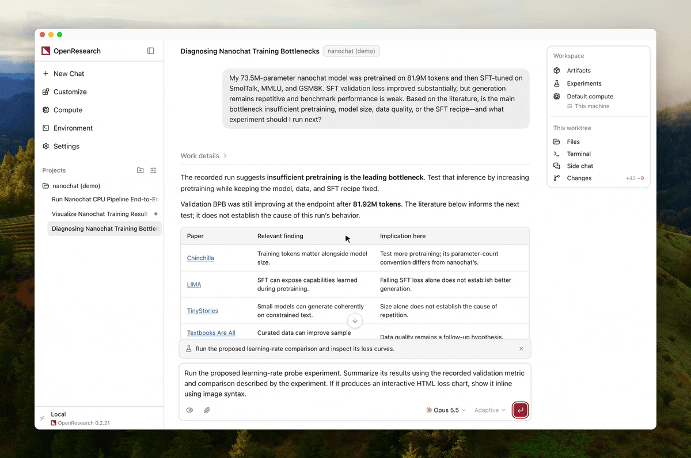
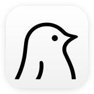

<div align="center">

<h1> OpenResearch</h1>

పరిశోధన ఏజెంట్‌ల కోసం లోకల్-ఫస్ట్ హార్నెస్ మరియు వర్క్‌స్పేస్.

<p><em>an <a href="https://alphaxiv.org"> alphaXiv</a> project</em></p>

<p>
<a href="https://github.com/alphaXiv/OpenResearch/releases/latest"></a>
<a href="https://github.com/alphaXiv/OpenResearch/blob/main/LICENSE"></a>
</p>

<p><a href="README.md">English</a> · <a href="README.es.md">Español</a> · <a href="README.ko.md">한국어</a> · <a href="README.zh.md">简体中文</a> · <a href="README.ja.md">日本語</a> · <a href="README.ru.md">Русский</a> · <a href="README.tr.md">Türkçe</a> · <a href="README.vi.md">Tiếng Việt</a> · <a href="README.hi.md">हिन्दी</a> · <a href="README.te.md">తెలుగు</a></p>

<p></p>

<hr />

<p>మీకు కోపైలట్ కావాలన్నా, ఆటోరీసెర్చ్ టూల్ కావాలన్నా, OpenResearch మీ పనిని వేగవంతం చేస్తుంది. సాహిత్యాన్ని సమీక్షించగల, పరికల్పనలను రూపొందించగల, ప్రయోగాలను రన్ చేయగల, పరిశోధన ఆర్టిఫ్యాక్ట్‌లను తయారు చేయగల పరిశోధన ఏజెంట్‌లను ప్రారంభించండి.</p>

<p>
<a href="https://openresearch.sh/dl/macos?src=github"><picture><source media="(prefers-color-scheme: dark)" srcset=".github/readme-assets/download-macos-dark.svg"></picture></a>
<a href="https://openresearch.sh/dl/windows?src=github"><picture><source media="(prefers-color-scheme: dark)" srcset=".github/readme-assets/download-windows-dark.svg"></picture></a>
<a href="https://openresearch.sh/dl/linux_x64?src=github"><picture><source media="(prefers-color-scheme: dark)" srcset=".github/readme-assets/download-linux-dark.svg"></picture></a>
</p>

<p>
<a href="https://openresearch.sh/docs"></a>
<a href="https://github.com/alphaXiv/OpenResearch/releases"></a>
</p>

<p><sub>macOS 11+ · Windows బీటాకు <a href="https://gitforwindows.org">Git for Windows</a> అవసరం · <a href="https://openresearch.sh/docs/install">Linux</a> యాప్‌కు glibc 2.35+ అవసరం</sub></p>

<p><a href="https://trendshift.io/repositories/89363"></a>
<a href="https://trendshift.io/repositories/89363?utm_source=trendshift-badge&amp;utm_medium=badge&amp;utm_campaign=badge-trendshift-89363" target="_blank" rel="noopener noreferrer"></a></p>

</div>

## ప్రారంభించండి

**OpenResearch డెస్క్‌టాప్ యాప్‌ను ఉపయోగించాలని మేము సిఫార్సు చేస్తున్నాము.** మీ ప్లాట్‌ఫామ్ కోసం దీన్ని డౌన్‌లోడ్ చేయండి:

- [macOS](https://openresearch.sh/dl/macos?src=github)
- [Windows (బీటా)](https://openresearch.sh/dl/windows?src=github)
- Linux: [x86_64](https://openresearch.sh/dl/linux_x64?src=github) · [ARM64](https://openresearch.sh/dl/linux_arm64?src=github)

<details>
<summary>స్టాండలోన్ CLI కావాలా? macOS లేదా Linuxలో ఇన్‌స్టాల్ చేయండి</summary>

```sh
curl -LsSf https://openresearch.sh/install.sh | sh
orx up
```

`orx up` లోకల్ డాష్‌బోర్డ్‌ను `http://127.0.0.1:4791` వద్ద తెరుస్తుంది.

సంస్థ నిర్వహించే Macలో, `install.sh` ద్వారా ఇన్‌స్టాల్ చేసిన CLI ఇంకా సైన్ చేయబడనందున
పరికర నిర్వహణ విధానాలు దాన్ని బ్లాక్ చేయవచ్చు. దానికి బదులుగా సైన్ చేసిన, నోటరైజ్ చేసిన
డెస్క్‌టాప్ యాప్‌ను ఉపయోగించండి. యాప్‌లోని సెట్టింగ్‌లు → అప్‌డేట్‌లు → **`orx` కమాండ్‌ను ఇన్‌స్టాల్ చేయండి**
నుండి కూడా మీ టెర్మినల్ కోసం `orx`‌ను ఇన్‌స్టాల్ చేసుకోవచ్చు.

</details>

ఈమెయిల్ అప్‌డేట్‌లు పొందడానికి, OpenResearch నిర్వహించే కంప్యూట్‌ను ఉపయోగించడానికి
[openresearch.sh](https://openresearch.sh)లో ఖాతాను సృష్టించండి.

## ఇది ఎలా పనిచేస్తుంది

**మీకు ఇష్టమైన కోడింగ్ ఏజెంట్‌ను ఉపయోగించండి.** OpenResearch  Claude Code,
 Codex,
 OpenCode,
 Cursor మరియు
 Google Antigravityతో నేరుగా పనిచేస్తుంది.
OpenCodeతో
 LM Studio,
 oMLX,
 Rapid-MLX,
 Ollama లేదా కస్టమ్ ఎండ్‌పాయింట్ ద్వారా [లోకల్ మోడల్‌ను కూడా ఉపయోగించవచ్చు](https://openresearch.sh/docs/agents).

**తాజా సాహిత్యం ఆధారంగా పరిశోధన పరికల్పనలను రూపొందించండి.** OpenResearch  alphaXiv,  bioRxiv మరియు  PubMedతో అనుసంధానమవుతుంది, కాబట్టి ఏజెంట్‌లు సంబంధిత పేపర్‌లను కనుగొనగలవు, ఆలోచనాత్మకమైన పరికల్పనలను రూపొందించగలవు, తమ ప్రయోగాలను ఇప్పటికే ఉన్న పరిశోధనతో అనుసంధానించగలవు.

**మీ కంప్యూట్‌ను ఎంచుకోండి.** ప్రయోగాలను లోకల్‌గా రన్ చేయండి, లేదా SSH,
Slurm,
 Kubernetes,
 Modal,
 Tinker,
 Ray,
 Hugging Face Jobs మరియు
OpenResearch నిర్వహించే కంప్యూట్‌ను ఉపయోగించండి.

**ప్రతి ప్రయోగాన్ని ఏజెంట్‌లు గుర్తుంచుకునేలా చేయండి.** OpenResearch ప్రతి ప్రయోగాన్ని లోకల్ SQL డేటాబేస్‌లో నమోదు చేస్తుంది, దాని లాగ్‌లు, కోడ్,
ఆర్టిఫ్యాక్ట్‌లను మీ మెషిన్‌లోనే ఉంచుతుంది. దీనివల్ల ఏజెంట్‌లు
గత ఫలితాల నుండి నేర్చుకుని, తర్వాత ఏం ప్రయత్నించాలో నిర్ణయించుకోగలవు. మీ ఏజెంట్‌లు ఏం చేశాయో చూడటం,
ప్రతి ఫలితం వెనుక ఉన్న ఆధారాలను పరిశీలించడం డెస్క్‌టాప్ యాప్‌తో సులభం.

**మీ పరిశోధన మీదే, మీ దగ్గరే.** పూర్తిగా లోకల్‌గా రన్ చేయండి. మేము మీ కోడ్‌ను గానీ ఏజెంట్ ట్రేస్‌లను గానీ సేకరించము. మీ ప్రాజెక్ట్‌లు,
సంభాషణలు, ప్రయోగాలు, లాగ్‌లు, ఆర్టిఫ్యాక్ట్‌లు మీ మెషిన్‌లోనే, మీ
నియంత్రణలోనే ఉంటాయి.

## వినియోగ అనలిటిక్స్

అధికారిక రిలీజ్ బిల్డ్‌లు బ్యాక్‌గ్రౌండ్‌లో స్థూలమైన ప్రోడక్ట్ అనలిటిక్స్ ఈవెంట్‌లను, వివరమైన ఏజెంట్ ఫీడ్‌బ్యాక్‌ను పంపుతాయి. ఇవి యాదృచ్ఛిక
ఇన్‌స్టాలేషన్ IDకి ముడిపడి ఉంటాయి. ఇవి డిఫాల్ట్‌గా ఆన్‌లో ఉంటాయి, మీరు వీటిని ఆఫ్ చేయవచ్చు. మీ కోడ్, ప్రాంప్ట్‌లు, ఫైల్ కంటెంట్ లేదా పాత్‌లు,
రిపోజిటరీ పేర్లు, టోకెన్‌లు, ఈమెయిల్‌లు, ప్రాజెక్ట్ లేదా ప్రయోగ ఐడెంటిఫైయర్‌లు సేకరించబడవు. OpenResearch అంతటా ఏ మోడల్‌లు ఉపయోగించబడుతున్నాయో
గుర్తించడానికి అనామక టోకెన్/సందేశ గణనలు ఉపయోగించబడతాయి, వాటిని https://openresearch.sh/rankings లో చూడవచ్చు. బగ్ రిపోర్ట్‌లు,
ఫీచర్ అభ్యర్థనలు, OpenResearch గురించిన సాధారణ అసంతృప్తుల కోసం ఏజెంట్ నుండి ఫీడ్‌బ్యాక్ రిపోర్ట్‌లు పంపబడతాయి. మీ పరిశోధన లేదా కోడ్
గురించిన ఎలాంటి సున్నితమైన సమాచారమూ రిపోర్ట్‌లలో ఉండకుండా తొలగించమని ఏజెంట్‌లకు సూచించబడింది.

డెస్క్‌టాప్ యాప్
సెట్టింగ్‌లలో లేదా `orx telemetry off`‌తో మీరు అన్ని వినియోగ అనలిటిక్స్‌ను, ఏజెంట్ ఫీడ్‌బ్యాక్‌ను ఆఫ్ చేయవచ్చు.
