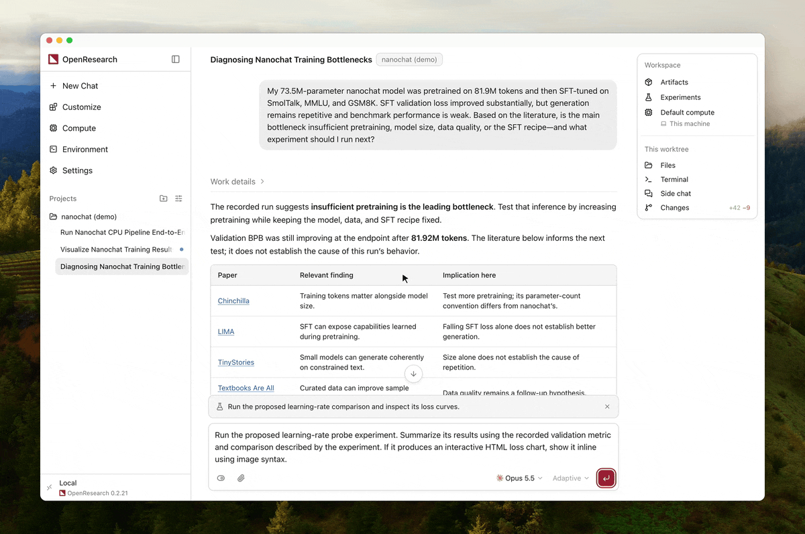
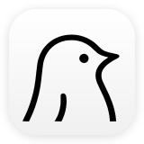

<div align="center">

<h1> OpenResearch</h1>

Araştırma ajanları için yerel öncelikli harness ve çalışma alanı.

<p><em>bir <a href="https://alphaxiv.org"> alphaXiv</a> projesi</em></p>

<p>
<a href="https://github.com/alphaXiv/OpenResearch/releases/latest"></a>
<a href="https://github.com/alphaXiv/OpenResearch/blob/main/LICENSE"></a>
</p>

<p><a href="README.md">English</a> · <a href="README.es.md">Español</a> · <a href="README.ko.md">한국어</a> · <a href="README.zh.md">简体中文</a> · <a href="README.ja.md">日本語</a> · <a href="README.ru.md">Русский</a> · <a href="README.tr.md">Türkçe</a></p>

<p></p>

<hr />

<p>İster bir copilot ister bir otomatik araştırma aracı arıyor olun, OpenResearch çalışmanızı hızlandırır. Literatürü inceleyebilen, hipotezler geliştirebilen, deneyler çalıştırabilen ve araştırma çıktıları üretebilen araştırma ajanları başlatın.</p>

<p>
<a href="https://github.com/alphaXiv/OpenResearch/releases/latest/download/OpenResearch.dmg"><picture><source media="(prefers-color-scheme: dark)" srcset=".github/readme-assets/download-macos-dark.svg"></picture></a>
<a href="https://github.com/alphaXiv/OpenResearch/releases/latest/download/OpenResearch-Setup.exe"><picture><source media="(prefers-color-scheme: dark)" srcset=".github/readme-assets/download-windows-dark.svg"></picture></a>
<a href="https://github.com/alphaXiv/OpenResearch/releases/latest/download/OpenResearch-x86_64.AppImage"><picture><source media="(prefers-color-scheme: dark)" srcset=".github/readme-assets/download-linux-dark.svg"></picture></a>
</p>

<p>
<a href="https://openresearch.sh/docs"></a>
<a href="https://github.com/alphaXiv/OpenResearch/releases"></a>
</p>

<p><sub>macOS 11+ · Windows beta sürümü <a href="https://gitforwindows.org">Git for Windows</a> gerektirir · <a href="https://openresearch.sh/docs/install">Linux</a> uygulaması glibc 2.35+ gerektirir</sub></p>

<p><a href="https://trendshift.io/repositories/89363"></a>
<a href="https://trendshift.io/repositories/89363?utm_source=trendshift-badge&amp;utm_medium=badge&amp;utm_campaign=badge-trendshift-89363" target="_blank" rel="noopener noreferrer"></a></p>

</div>

## Başlarken

**OpenResearch masaüstü uygulamasını kullanmanızı öneririz.** Platformunuz için indirin:

- [macOS](https://github.com/alphaXiv/OpenResearch/releases/latest/download/OpenResearch.dmg)
- [Windows (Beta)](https://github.com/alphaXiv/OpenResearch/releases/latest/download/OpenResearch-Setup.exe)
- Linux: [x86_64](https://github.com/alphaXiv/OpenResearch/releases/latest/download/OpenResearch-x86_64.AppImage) · [ARM64](https://github.com/alphaXiv/OpenResearch/releases/latest/download/OpenResearch-aarch64.AppImage)

<details>
<summary>Tek başına CLI'yi mi tercih ediyorsunuz? macOS veya Linux'a kurun</summary>

```sh
curl -LsSf https://openresearch.sh/install.sh | sh
orx up
```

`orx up`, yerel panoyu `http://127.0.0.1:4791` adresinde açar.

Yönetilen bir Mac'te cihaz yönetimi politikaları, `install.sh` ile kurulan
CLI'yi imzalanmadığı için engelleyebilir. Bunun yerine imzalanmış ve noter
onaylı masaüstü uygulamasını kullanın. `orx` komutunu terminaliniz için
uygulamanın Ayarlar → Güncellemeler → **`orx` komutunu yükle** bölümünden de
kurabilirsiniz.

</details>

E-posta güncellemeleri almak ve yönetilen OpenResearch hesaplama kaynaklarını
kullanmak için [openresearch.sh](https://openresearch.sh) adresinde bir hesap
oluşturun.

## Nasıl çalışır

**En sevdiğiniz kodlama ajanını kullanın.** OpenResearch,  Claude Code,
 Codex,
 OpenCode,
 Cursor ve
 Google Antigravity ile yerel olarak çalışır.
Ayrıca OpenCode ile
 LM Studio,
 oMLX,
 Ollama veya özel bir uç nokta aracılığıyla
[yerel bir model kullanabilirsiniz](https://openresearch.sh/docs/agents).

**Araştırma hipotezlerinizi en güncel literatüre dayandırın.** OpenResearch,  alphaXiv,  bioRxiv ve  PubMed ile entegre çalışır; böylece ajanlar ilgili makaleleri bulabilir, bilgiye dayalı hipotezler geliştirebilir ve deneylerini mevcut araştırmalarla ilişkilendirebilir.

**Hesaplamanızı seçin.** Deneyleri yerel olarak çalıştırın veya SSH,
Slurm,
 Kubernetes,
 Modal,
 Tinker,
 Ray,
 Hugging Face Jobs ve
yönetilen OpenResearch hesaplama kaynaklarını kullanın.

**Ajanlara her deneyin belleğini verin.** OpenResearch her deneyi yerel bir SQL veritabanına kaydeder; günlükleri, kodu
ve çıktıları makinenizde tutar; böylece ajanlar
geçmiş sonuçlardan öğrenip sırada ne deneyeceklerine karar verebilir. Masaüstü uygulaması,
ajanlarınızın neler yaptığını görmeyi ve her sonucun arkasındaki kanıtı incelemeyi
kolaylaştırır.

**Araştırmanızı koruyun ve sahiplenin.** Tamamen yerel olarak çalışın. Kodunuzu veya ajan izlerinizi toplamıyoruz. Projeleriniz,
konuşmalarınız, deneyleriniz, günlükleriniz ve çıktılarınız makinenizde, sizin
kontrolünüzde kalır.

## Kullanım analitiği

Resmi sürüm derlemeleri, arka planda rastgele bir kurulum kimliğine bağlı olarak
devre dışı bırakılabilir, ayrıntı düzeyi düşük ürün analitiği olayları ve ayrıntılı ajan geri bildirimi gönderir. Kodunuz, prompt'larınız, dosya içerikleriniz veya yollarınız,
depo adlarınız, token'larınız, e-postalarınız ya da proje ve deney tanımlayıcılarınız toplanmaz. OpenResearch genelinde
hangi modellerin kullanıldığını belirlemek için anonimleştirilmiş token/mesaj sayıları kullanılır ve bu bilgiler
https://openresearch.sh/rankings adresinde görülebilir. Ajanlardan gelen geri bildirim raporları
hata bildirimleri, özellik istekleri ve OpenResearch hakkındaki genel sıkıntılar için gönderilir. Ajanlara,
araştırmanız veya kodunuz hakkındaki hassas bilgileri hariç tutmak için raporları temizleme
talimatı verilir.

Tüm kullanım analitiğini ve ajan geri bildirimini masaüstü uygulamasının
Ayarlar bölümünden veya `orx telemetry off` komutuyla kapatabilirsiniz.
