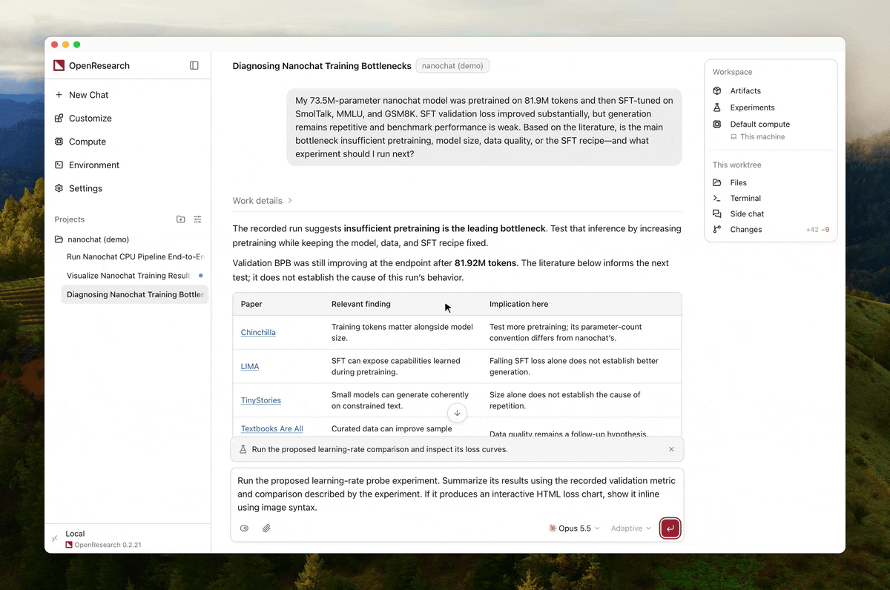

<div align="center">

<h1> OpenResearch</h1>

Bộ công cụ và không gian làm việc ưu tiên chạy cục bộ cho agent nghiên cứu.

<p><em>Dự án của <a href="https://alphaxiv.org"> alphaXiv</a></em></p>

<p>
<a href="https://github.com/alphaXiv/OpenResearch/releases/latest"></a>
<a href="https://github.com/alphaXiv/OpenResearch/blob/main/LICENSE"></a>
</p>

<p><a href="README.md">English</a> · <a href="README.es.md">Español</a> · <a href="README.ko.md">한국어</a> · <a href="README.zh.md">简体中文</a> · <a href="README.ja.md">日本語</a> · <a href="README.ru.md">Русский</a> · <a href="README.tr.md">Türkçe</a> · <a href="README.vi.md">Tiếng Việt</a> · <a href="README.hi.md">हिन्दी</a> · <a href="README.te.md">తెలుగు</a></p>

<p></p>

<hr />

<p>Dù bạn cần một trợ lý lập trình hay công cụ tự động hóa nghiên cứu, OpenResearch giúp đẩy nhanh công việc nghiên cứu. Khởi chạy các agent nghiên cứu để đọc tài liệu, phát triển giả thuyết, chạy thí nghiệm và tạo tệp đầu ra như báo cáo, biểu đồ và hình ảnh.</p>

<p>
<a href="https://openresearch.sh/dl/macos?src=github"><picture><source media="(prefers-color-scheme: dark)" srcset=".github/readme-assets/download-macos-dark.svg"></picture></a>
<a href="https://openresearch.sh/dl/windows?src=github"><picture><source media="(prefers-color-scheme: dark)" srcset=".github/readme-assets/download-windows-dark.svg"></picture></a>
<a href="https://openresearch.sh/dl/linux_x64?src=github"><picture><source media="(prefers-color-scheme: dark)" srcset=".github/readme-assets/download-linux-dark.svg"></picture></a>
</p>

<p>
<a href="https://openresearch.sh/docs"></a>
<a href="https://github.com/alphaXiv/OpenResearch/releases"></a>
</p>

<p><sub>macOS 11+ · Windows beta yêu cầu ứng dụng <a href="https://gitforwindows.org">Git cho Windows</a> · ứng dụng <a href="https://openresearch.sh/docs/install">Linux</a> cần glibc 2.35+</sub></p>

<p><a href="https://trendshift.io/repositories/89363"></a>
<a href="https://trendshift.io/repositories/89363?utm_source=trendshift-badge&amp;utm_medium=badge&amp;utm_campaign=badge-trendshift-89363" target="_blank" rel="noopener noreferrer"></a></p>

</div>

## Bắt đầu

**Khuyến nghị: dùng ứng dụng desktop OpenResearch.** Tải ứng dụng cho nền tảng của bạn:

- [macOS](https://openresearch.sh/dl/macos?src=github)
- [Windows (Beta)](https://openresearch.sh/dl/windows?src=github)
- Linux: [x86_64](https://openresearch.sh/dl/linux_x64?src=github) · [ARM64](https://openresearch.sh/dl/linux_arm64?src=github)

<details>
<summary>Bạn thích CLI độc lập hơn? Cài đặt trên macOS hoặc Linux</summary>

```sh
curl -LsSf https://openresearch.sh/install.sh | sh
orx up
```

`orx up` mở bảng điều khiển cục bộ tại `http://127.0.0.1:4791`.

Trên máy Mac do tổ chức quản lý, chính sách quản lý thiết bị có thể chặn CLI cài bằng `install.sh` vì CLI chưa được ký. Hãy dùng ứng dụng desktop đã được ký và công chứng. Bạn cũng có thể cài lệnh `orx` cho terminal từ **Cài đặt → Cập nhật → Cài đặt lệnh `orx`**.

</details>

Tạo tài khoản tại [openresearch.sh](https://openresearch.sh) để nhận thông tin cập nhật qua email và sử dụng dịch vụ điện toán do OpenResearch quản lý.

## Cách thức hoạt động

**Dùng agent lập trình bạn yêu thích.** OpenResearch hỗ trợ trực tiếp  Claude Code,
 Codex,
 OpenCode,
 Cursor và
 Google Antigravity.
Bạn cũng có thể [dùng mô hình cục bộ](https://openresearch.sh/docs/agents) với OpenCode thông qua
 LM Studio,
 oMLX,
 Rapid-MLX,
 Ollama hoặc điểm cuối tùy chỉnh.

**Xây dựng giả thuyết nghiên cứu dựa trên tài liệu mới nhất.** OpenResearch tích hợp với  alphaXiv,  bioRxiv và  PubMed để agent tìm các bài nghiên cứu liên quan, xây dựng giả thuyết có cơ sở và kết nối thí nghiệm với nghiên cứu hiện có.

**Chọn nơi chạy thí nghiệm.** Chạy thí nghiệm cục bộ hoặc sử dụng SSH,
Slurm,
 Kubernetes,
 Modal,
 Tinker,
Ray ,
 Hugging Face Jobs và
dịch vụ điện toán do OpenResearch quản lý.

**Giúp agent ghi nhớ mọi thí nghiệm.** OpenResearch ghi lại từng thí nghiệm trong cơ sở dữ liệu SQL trên máy và lưu nhật ký, mã nguồn cùng tệp đầu ra tại đó. Nhờ vậy, agent có thể học từ kết quả trước và chọn bước tiếp theo. Ứng dụng desktop giúp bạn xem agent đã làm gì và kiểm tra bằng chứng đằng sau từng kết quả.

**Nghiên cứu của bạn luôn nằm trong quyền kiểm soát của bạn.** Bạn có thể chạy hoàn toàn cục bộ. OpenResearch không thu thập mã nguồn hoặc dấu vết hoạt động của agent. Dự án, cuộc trò chuyện, thí nghiệm, nhật ký và tệp đầu ra được lưu trên máy của bạn.

## Phân tích mức sử dụng

Các bản phát hành chính thức gửi trong nền một số sự kiện phân tích sản phẩm ở mức tổng quát (có thể tắt) và phản hồi chi tiết do agent gửi. Dữ liệu được gắn với một mã cài đặt ngẫu nhiên. OpenResearch không thu thập mã nguồn, lời nhắc, nội dung hoặc đường dẫn tệp, tên kho mã, token, email hay mã định danh dự án và thí nghiệm. Các số liệu ẩn danh về token và tin nhắn giúp xác định những mô hình được sử dụng trong OpenResearch; bạn có thể xem tại [trang xếp hạng](https://openresearch.sh/rankings). Agent được hướng dẫn loại bỏ thông tin nhạy cảm về nghiên cứu hoặc mã nguồn khỏi báo cáo phản hồi về lỗi, yêu cầu tính năng và các trải nghiệm chưa tốt.

Bạn có thể tắt toàn bộ phân tích sử dụng và phản hồi của agent trong **Cài đặt** hoặc chạy `orx telemetry off`.
